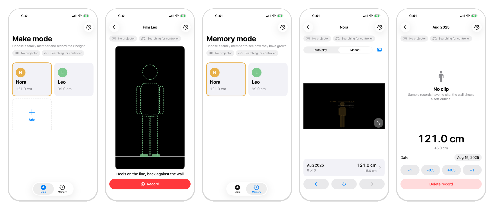
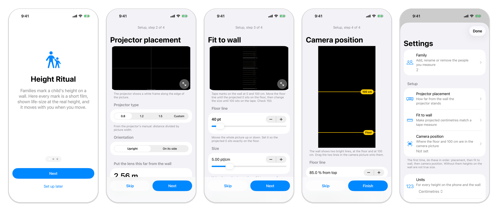
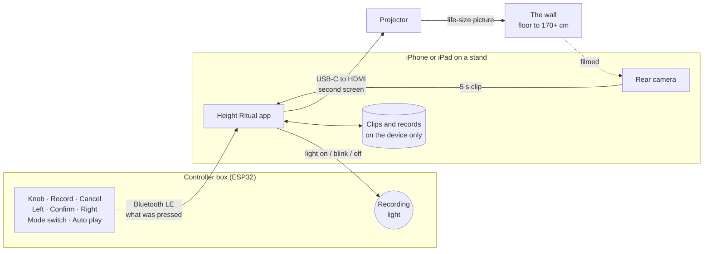
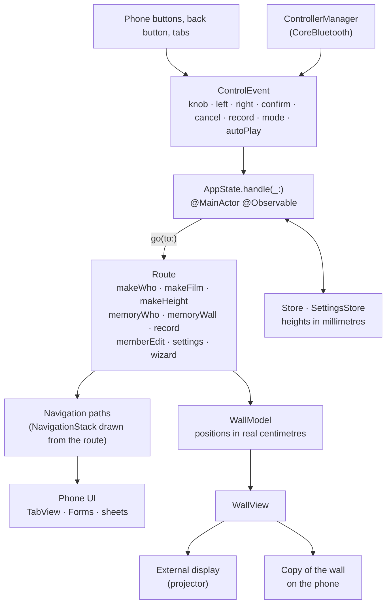
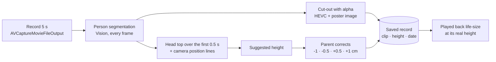

<p align="center">
  
</p>

<p align="center">
  
  
  
  
  
</p>

Families mark a child's height on a doorframe. The marks belong to that doorframe. The child
outgrows the house, the family moves or repaints, and the marks are gone.

**Height Ritual keeps the ritual and makes the record portable.** Someone stands at the wall and
is filmed for five seconds. The app suggests their height from the video and a parent corrects it.
Later, every past record comes back on the wall: the person cut out of their clip, **life-size, at
their real height**, with a pencil-like mark for each year.

Hi-fi prototype for KTH DM2601 (Media Technology and Interaction Design), Group 6.

---

## How it works

| | Make | Memory |
|---|---|---|
| **What you do** | Choose who it is, stand with your heels on the line, film 5 seconds. Check the height, save. | Choose who to look back on. Step through the records with the knob, or let them play from the first to the newest. |
| **On the wall** | Foot marks and an outline where to stand, then a 3-2-1 countdown. | Every mark, and the selected clip playing life-size at its real height. |
| **In your hands** | A wireless box with a mode switch, a knob, Record, Cancel, Left / Confirm / Right and a red recording light. Every control also works on the phone. | |

<p align="center">
  
  <br>
  <sub>Make: choose a member · film with the foot guide &nbsp;|&nbsp; Memory: choose a member · memory wall · record detail</sub>
</p>

### One-time setup

A projected centimetre has to be a real centimetre. Three steps, guided by a wizard on first launch:

1. **Projector placement**: the throw ratio gives the distance from the lens to the wall.
2. **Fit to wall**: move and scale the projected ruler until 0 and 100 sit on a tape measure.
3. **Camera position**: drag two lines in the camera picture onto the projected 0 and 100 cm
   lines, so heights can be read from the video.

<p align="center">
  
</p>

---

## System



The controller only reports what was used. The app decides what it means on each screen.

## App architecture

One state machine drives both screens. Views and the controller send events; nothing else
changes the route.



- **Single source of truth.** `AppState` owns the route. The `NavigationStack` path is computed
  from it, so the system back button, a swipe and the controller's Cancel all do the same thing.
- **Real units.** Wall positions are computed in centimetres by `WallGeometry`; heights are stored
  in millimetres and only formatted through `HeightFormatter`, so cm and ft/in apply everywhere.
- **Two screens, one model.** The projector scene and the phone's copy of the wall draw the same
  `WallModel` and share one `AVPlayer`.

## From clip to life-size record



Nobody found in the clip? The app says so and offers Retake, or keeps the clip anyway with the
height set by hand.

---

## Screens

| | Screen | |
|---|---|---|
| **W** | Welcome (3 pages) and the setup wizard | first launch |
| **M1 → M2 → M3** | Choose a member → Film → Height | Make tab |
| **R1 → R2 → R3** | Choose a member → Memory wall → Record detail | Memory tab (the app opens here) |
| **A1** | Add or edit a family member | sheet |
| **S, S1 to S6** | Settings: family, placement, fit to wall, camera position, units, permissions, controller | sheet |

Every screen, captured: [`docs/images/screens/`](docs/images/screens). The full spec with the
controller table per screen: [`docs/SPEC.md`](docs/SPEC.md).

Design rules: one decision per screen, one obvious next action, system controls, targets of at
least 44 pt, no hidden gestures. Light and dark appearance. English, Korean, Simplified Chinese and
Swedish, chosen in Settings.

## Controller

| Control | On the choose screens | Film | Height | Memory wall |
|---|---|---|---|---|
| Knob | Move highlight | | ±0.5 cm | Previous / next record |
| Left / Right | Move highlight | | ±1 cm | Previous / next record |
| Confirm | Open | Start countdown | Save | Replay |
| Cancel | | Back | Retake | Back |
| Record / Stop | | Start / stop early | | |
| Auto play | | | | Start / stop |
| Mode switch | Make or Memory, on any screen | | | |

Firmware: [`Firmware/controller/`](Firmware/controller) (full box),
[`Firmware/controller_buttons/`](Firmware/controller_buttons) (buttons only, for the current
breadboard), [`Firmware/wiring_test/`](Firmware/wiring_test) (serial check of every input).

---

## Project layout

```
HeightRitual/
├── App/          app entry, external display scene
├── State/        AppState, Route, navigation paths, scheduler
├── Input/        ControlEvent, ControllerManager (Bluetooth LE)
├── Capture/      camera, VideoCutout (Vision + alpha HEVC), height estimate, foot guide
├── Playback/     WallPlayer (one AVPlayer for wall and phone)
├── Wall/         WallModel, WallView, WallGeometry
├── Model/        Store, SettingsStore, HeightFormatter, models
├── Phone/        SwiftUI screens; Settings/ holds S1 to S6 and the wizard
└── Resources/    Localizable.xcstrings (en, ko, zh-Hans, sv), assets
HeightRitualTests/    unit tests: state machine, controller table, protocol, wall model, store
HeightRitualUITests/  random navigation stress test, README screenshots
Firmware/             ESP32 sketches
docs/                 SPEC.md (what), IMPLEMENTATION.md (how), images
```

## Getting started

Needs a Mac with a recent Xcode (built with Xcode 26) and an iPhone or iPad on iOS 17 or later.

```bash
brew install xcodegen
xcodegen                     # generates HeightRitual.xcodeproj from project.yml
open HeightRitual.xcodeproj
```

Set your own team in `project.yml` (`DEVELOPMENT_TEAM`) before running on a device.
"Load sample family" in Settings fills Memory with Nora and Leo, so the app can be tried without
filming anyone.

```bash
# unit tests
xcodebuild test -project HeightRitual.xcodeproj -scheme HeightRitual \
  -destination 'platform=iOS Simulator,name=iPhone 16' -only-testing:HeightRitualTests

# 60 random steps through the app, checking the tab bar after every step
xcodebuild test -project HeightRitual.xcodeproj -scheme HeightRitual \
  -destination 'platform=iOS Simulator,name=iPhone 16' \
  -only-testing:HeightRitualUITests/NavigationStressTests/testRandomNavigationKeepsTheTabBarRight
```

## Status

| Part | State |
|---|---|
| State machine, navigation, all phone screens, wall drawing, settings, wizard, 4 languages | Done, 55 unit tests and the UI stress test pass in the simulator |
| Controller over Bluetooth LE | Connects on a device; button input still being checked on the breadboard |
| Camera, cut-out, alpha video playback, projector scene | Written; needs testing on a device with a projector |
| Live foot check while filming, automatic camera position | Not built |

## Privacy

Clips of family members never leave the phone. The app has no networking code, no accounts and
no third-party packages. Everything is stored in the app's own container.

---

<sub>KTH Royal Institute of Technology · DM2601 Media Technology and Interaction Design · Group 6 · 2026</sub>
