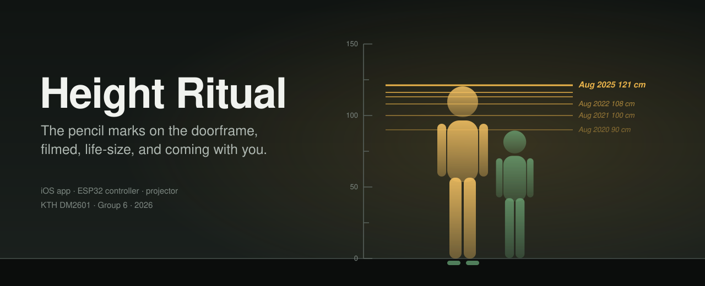
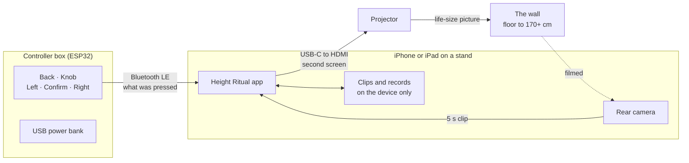
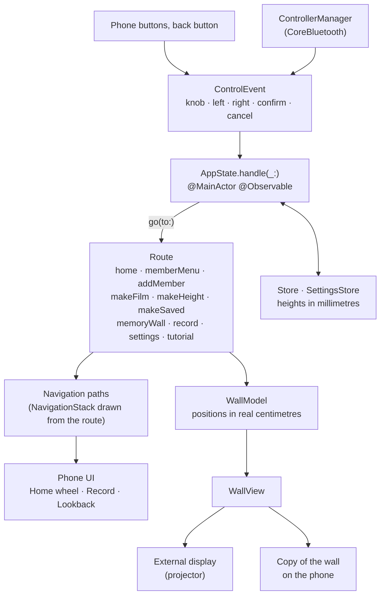
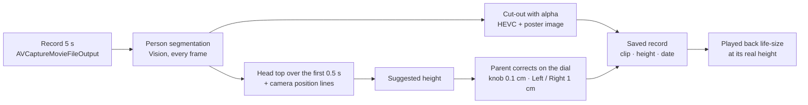

<p align="center">
  
</p>

<p align="center">
  
  
  
  
  
</p>

Families mark a child's height on a doorframe. The marks belong to that doorframe. The child
outgrows the house, the family moves or repaints, and the marks are gone.

**Memory Meter keeps the ritual and makes the record portable.** Someone stands at the wall and
is filmed for five seconds. The app suggests their height from the video and a parent corrects it.
Later, every past record comes back on the wall: the person cut out of their clip, **life-size, at
their real height**, with a pencil-like mark for each year.

The app is called Memory Meter; the project and code keep the working name Height Ritual.
Hi-fi prototype for KTH DM2601 (Media Technology and Interaction Design), Group 6.

---

## How it works

Everything starts from a person. Home is a wheel of family members with an Add card at the end;
choosing someone opens a small menu with two actions.

| | Record | Lookback |
|---|---|---|
| **What you do** | Stand with your heels on the line, press Confirm, film 5 seconds. Check the height on the dial, save. | Step through the records with the knob, or let them play from the first to the newest. |
| **On the wall** | Foot marks and an outline where to stand, then a 3-2-1 countdown. | Every mark, and the selected clip playing life-size at its real height. |
| **In your hands** | A wireless box with Back, a knob, Left, Confirm and Right. Every control also works on the phone. | |

New members get their name from a letter wheel, so the whole app can be used from the controller.
Every phone page has a matching wall version, and Settings opens on the wall as a grid of tiles.
On first launch a short onboarding walks through the controls with the box in hand.

### One-time setup

A projected centimetre has to be a real centimetre. Two steps, guided by a wizard on first launch:

1. **Fit to wall**: move the floor line and change the size until the projected 0 and 100 sit on
   a tape measure.
2. **Camera position**: drag two lines in the camera picture onto the projected 0 and 100 cm
   lines, so heights can be read from the video.

The Setup guide in Settings shows where the projector and phone go (2.5 m from the wall, lens at
0.97 m). The wall image is always turned -90 degrees, because the group's projector lies on its side.

---

## System



The controller only reports what was used. The app decides what it means on each screen.

## App architecture

One state machine drives both screens. Views and the controller send events; nothing else
changes the route.



- **Single source of truth.** `AppState` owns the route. The `NavigationStack` path is computed
  from it, so the system back button, a swipe and the controller's Cancel all do the same thing.
- **Real units.** Wall positions are computed in centimetres by `WallGeometry`; heights are stored
  in millimetres and only formatted through `HeightFormatter`, so cm and ft/in apply everywhere.
- **Two screens, one model.** The projector scene and the phone's copy of the wall draw the same
  `WallModel` and share one `AVPlayer`.
- **One look.** Colours and fonts come only from `Theme` (black and white for now, Black Han Sans
  for titles); controller buttons are always drawn with `ControlIcon`.

## From clip to life-size record



Nobody found in the clip? The app says so and offers Retake, or keeps the clip anyway with the
height set by hand.

---

## Screens

| | Screen | |
|---|---|---|
| **T** | Onboarding with the controller: add someone, film, check, look back | first launch |
| **H** | Home: wheel of members, Add card at the end | the app opens here |
| **H1** | Member menu: Record or Lookback | overlay above Home |
| **A2** | Add a member: name from the letter wheel | from the Add card |
| **M2 → M3 → M4** | Film → Height check on the dial → Saved | Record |
| **R2 → R3** | Lookback (the memory wall) → one record | Lookback |
| **S** | Settings: setup guide, family, fit to wall, camera position, units, sound, controller, permissions, sample family, delete everything | Back on Home |

The full spec with the controller table per screen: [`docs/SPEC.md`](docs/SPEC.md).

Design rules: one decision per screen, one obvious next action, targets of at least 44 pt, no
hidden gestures. English only.

## Controller

```
 [ Back ]                    ( Knob )

 < Left       ( Confirm )      Right >
```

| Control | Home | Film | Height check | Lookback |
|---|---|---|---|---|
| Knob | Turn the wheel | | ±0.1 cm per click | Previous / next record |
| Left / Right | Previous / next card | | ±1 cm | Previous / next record |
| Confirm | Open the member menu | Start (3-2-1, 5 s) / stop early | Save | Replay |
| Back | Open Settings | Back to the member menu | Retake | Back to the member menu |

Auto play is a setting; in ft/in the steps are 1/4 inch and 1 inch.
Bluetooth LE device name `MemoryMeter`, packets `[controlId, value]` (SPEC section 6).

Firmware: [`Firmware/controller/`](Firmware/controller) (the v4 box, NimBLE + ESP32Encoder),
[`Firmware/controller_buttons/`](Firmware/controller_buttons) (old breadboard build),
[`Firmware/wiring_test/`](Firmware/wiring_test) (serial check of every input).

---

## Project layout

```
HeightRitual/
├── App/          app entry, external display scene
├── State/        AppState, Route, navigation paths, scheduler
├── Input/        ControlEvent, ControllerManager (Bluetooth LE)
├── Capture/      camera, VideoCutout (Vision + alpha HEVC), height estimate, foot guide
├── Playback/     WallPlayer (one AVPlayer for wall and phone)
├── Wall/         WallModel, WallView, WallGeometry
├── Model/        Store, SettingsStore, HeightFormatter, models
├── Phone/        SwiftUI screens, each with its wall version
│   ├── Home/       wheel, member menu, letter wheel
│   ├── Record/     film, foot guide, height dial, saved
│   ├── Playback/   Lookback
│   ├── Settings/   phone list and projector grid pages, wizard
│   ├── Tutorial/   onboarding with the controller
│   └── Design/     Theme (colours, fonts), DesignKit
└── Resources/    assets, fonts
HeightRitualTests/    unit tests: state machine, controller table, protocol, wall model, store
HeightRitualUITests/  random navigation stress test, screenshot runs
Firmware/             ESP32 sketches
docs/                 SPEC.md (what), IMPLEMENTATION.md (how), images
```

## Getting started

Needs a Mac with a recent Xcode (built with Xcode 26) and an iPhone or iPad on iOS 17 or later.

```bash
brew install xcodegen
xcodegen                     # generates HeightRitual.xcodeproj from project.yml
open HeightRitual.xcodeproj
```

Set your own team in `project.yml` (`DEVELOPMENT_TEAM`) before running on a device.
"Load sample family" in Settings adds Nora and Leo with past records, so Lookback can be tried
without filming anyone. In Debug builds the projector button on every page shows the wall version
on the phone with the controller's buttons, and the `-DebugFakeClip` launch argument fakes a filmed
clip in the simulator.

```bash
# unit tests
xcodebuild test -project HeightRitual.xcodeproj -scheme HeightRitual \
  -destination 'platform=iOS Simulator,name=iPhone 16' -only-testing:HeightRitualTests

# random steps through the app
xcodebuild test -project HeightRitual.xcodeproj -scheme HeightRitual \
  -destination 'platform=iOS Simulator,name=iPhone 16' \
  -only-testing:HeightRitualUITests/NavigationStressTests
```

## Status

| Part | State |
|---|---|
| State machine, Home wheel, Record and Lookback, settings, onboarding, wall versions of every page | Done, 70 unit tests pass in the simulator |
| Controller v4 over Bluetooth LE | Connects on a device; firmware for the soldered box, knob read with ESP32Encoder |
| Camera, cut-out, alpha video playback, projector scene | Written; needs testing on a device with a projector |
| Live foot check while filming, automatic camera position | Not built |

## Privacy

Clips of family members never leave the phone. The app has no networking code, no accounts and
no third-party packages. Everything is stored in the app's own container.

---

<sub>KTH Royal Institute of Technology · DM2601 Media Technology and Interaction Design · Group 6 · 2026</sub>
